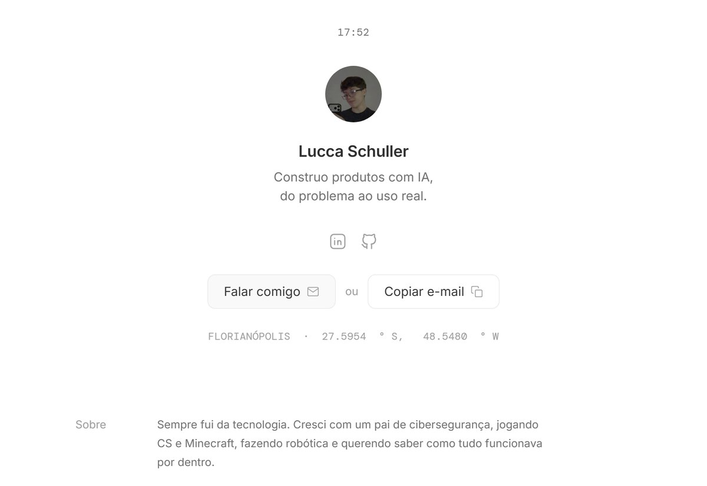

# Portfólio de Lucca Schuller

Meu site pessoal, com os produtos que construo com IA.

**No ar:** [schullerlucca.github.io/portfolio](https://schullerlucca.github.io/portfolio/)

[](https://schullerlucca.github.io/portfolio/)

## O que tem no site

Seis casos de trabalho. Cada um conta o problema, o que fiz, uma decisão e onde está hoje.

- **Hurbana OS:** sistema interno que junta os dados da obra num só lugar. Em teste com a Engenharia, um time de 27 pessoas.
- **Liderar com IA:** treinamento de IA para 24 líderes da empresa, com aplicativo próprio criado em dois dias.
- **Inspeções de obra:** aplicativos no Base44 que chegaram a 1.800 inspeções no primeiro mês.
- **Auditoria automática de projetos:** RAG no Obsidian, com YAML e Python, que confere o modelo do Revit contra a legislação.
- **Liberação de projetos:** protótipo em n8n que avisa a obra quando uma revisão de projeto muda.
- **Schuller Labs:** newsletter sobre IA para negócios, com site próprio e pesquisa automatizada em n8n.

O código desses projetos não é público. Por isso o site mostra telas, números e decisões. A tela do Hurbana OS usa dados fictícios.

## Como foi feito

Uma página só, em HTML, CSS e JavaScript puros, sem framework nem etapa de build. Feito com Claude Code e publicado no GitHub Pages.

## Rodar localmente

```bash
python -m http.server 4321
```

Depois, abra http://localhost:4321.

## Créditos

- Layout inspirado em [remygaskell.com](https://www.remygaskell.com/).
- Logos das ferramentas: [Simple Icons](https://simpleicons.org/).
- Ícones de linha: [Tabler Icons](https://tabler.io/icons) e [Feather](https://feathericons.com/).
- Fontes: Inter e DM Mono, pelo Google Fonts.
